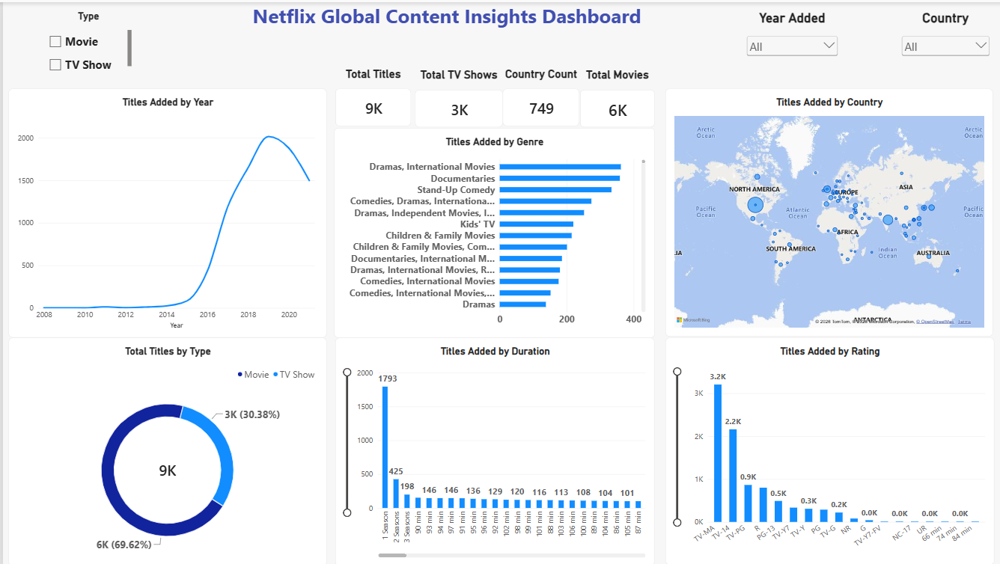

# Netflix Global Content Insights Dashboard --- Power BI

## Project Overview

This project uses a Netflix titles dataset containing **8,807 records
and 12 columns** to explore the distribution of Netflix movies and TV
shows across content type, year added, country, genre, duration, and
rating. It demonstrates data preparation, data-quality checks,
interactive visualization, and KPI reporting in Power BI.

## Dashboard



### Key KPIs

-   Total Titles
-   Total Movies
-   Total TV Shows
-   Country Count

### Interactive Analysis

The dashboard includes:

-   Titles Added by Year
-   Titles Added by Genre
-   Titles Added by Country
-   Total Titles by Type
-   Titles Added by Duration
-   Titles Added by Rating

### Filters

The dashboard includes interactive filters for:

-   **Type** --- Movie / TV Show
-   **Year Added**
-   **Country**

These filters support focused exploration of the dashboard visuals.

## Dataset

**Source file:** `netflix_titles(3).csv`

The dataset contains the following fields:

`show_id`, `type`, `title`, `director`, `cast`, `country`, `date_added`,
`release_year`, `rating`, `duration`, `listed_in`, `description`

## Data Quality and Preparation

-   Checked for duplicate records and duplicate `show_id` values.
-   Identified missing values in descriptive fields such as director,
    cast, country, date added, rating, and duration; missing values were
    retained where appropriate rather than replaced with invented
    information.
-   Used CSV quote-aware parsing during Power Query ingestion because
    quoted line breaks in CSV records required careful parsing.

## Tools & Technologies

-   Microsoft Power BI Desktop
-   Power Query
-   DAX
-   CSV
-   Kaggle Netflix titles dataset

## Power BI Concepts Demonstrated

-   Data import and transformation
-   Data type management
-   Handling missing values
-   CSV parsing and data-quality validation
-   DAX measures and KPI cards
-   Slicers and interactive filtering
-   Cross-filtering between visuals
-   Line, bar, and column charts
-   Donut chart and map visualization
-   Dashboard formatting and layout

## Business Questions

The broader Netflix analysis objectives associated with the project
include:

1.  Count movies versus TV shows.
2.  Identify common ratings for movies and TV shows.
3.  List movies released in a specified year.
4.  Find countries with the most Netflix content.
5.  Identify the longest movie.
6.  Find content added in the last five years.
7.  Find movies or TV shows by a specified director.
8.  List TV shows with more than five seasons.
9.  Count content items by genre.
10. Analyze yearly average content releases in India.
11. Identify documentary movies.
12. Find content without a director.
13. Analyze appearances by a specified actor.
14. Find actors with the highest number of appearances in
    Indian-produced movies.
15. Categorize content based on the presence of the keywords `kill` and
    `violence` in descriptions.

**Scope note:** The current Power BI dashboard focuses on the visual
analysis represented by its KPIs, charts, map, and slicers. The list
above describes the broader analysis objectives and should not be read
as a claim that every question is answered by the dashboard itself.

## Dashboard Values and Interpretation

The existing project notes report the following approximate unfiltered
dashboard values:

-   **9K Total Titles**
-   **6K Movies**
-   **3K TV Shows**
-   **749 Country Count**

The dashboard was also checked using filtered scenarios, including
Movie, TV Show, and TV Show + India selections.

The `country` field can contain multiple country names in a single
source record. Therefore, **Country Count** represents distinct
values/entries in the source field rather than a normalized count of
individual countries. Verify the displayed values against the current
dashboard before using them in an interview or presentation.

## Project Structure

``` text
Netflix Global Content Insights/
├── Netflix_Global_Content_Insights_Dashboard.pbix
├── netflix_titles(3).csv
├── README.md
└── dashboard-preview.png
```

The filenames above should match the actual files in the repository. If
the image or dataset has a different filename, update this section
accordingly.

## How to Use

1.  Download or clone the repository.
2.  Open `Netflix_Global_Content_Insights_Dashboard.pbix` in Power BI
    Desktop.
3.  If Power BI asks for the source file location, select
    `netflix_titles(3).csv`.
4.  Use the Type, Year Added, and Country filters to explore the
    dashboard.

## Key Takeaways and Business Interpretation

Use the dashboard to examine content mix, genre and country
distribution, ratings, durations, and yearly additions. Any specific
business takeaway should be based on the actual visuals and filter
selections. This README does not invent numerical trends or conclusions
that are not documented in the project materials.

## Project Objective

Demonstrate practical skills in Power BI data preparation, data-quality
validation, DAX measures, KPI reporting, interactive dashboards, and
exploratory analysis of a real-world content catalogue.
